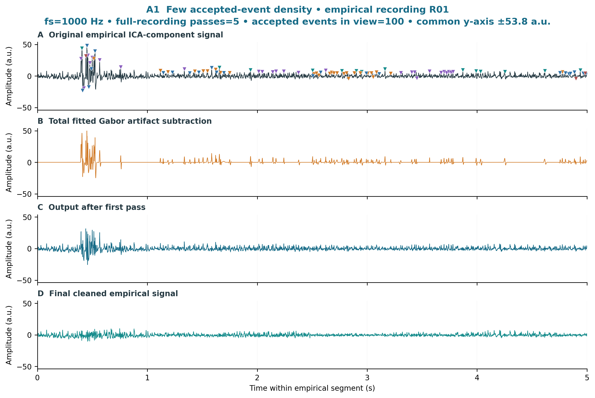
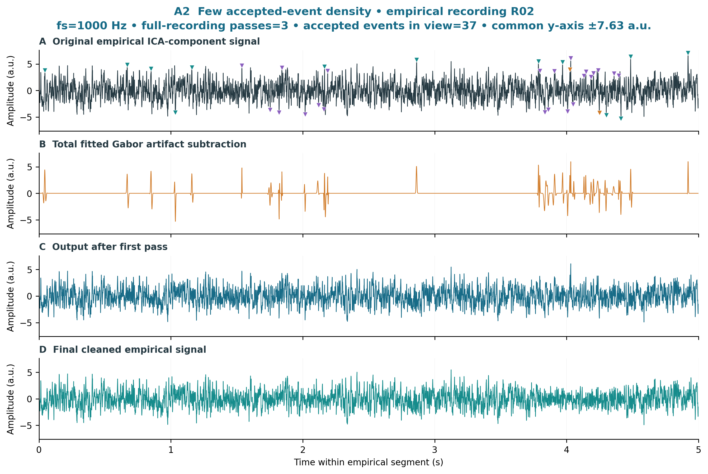
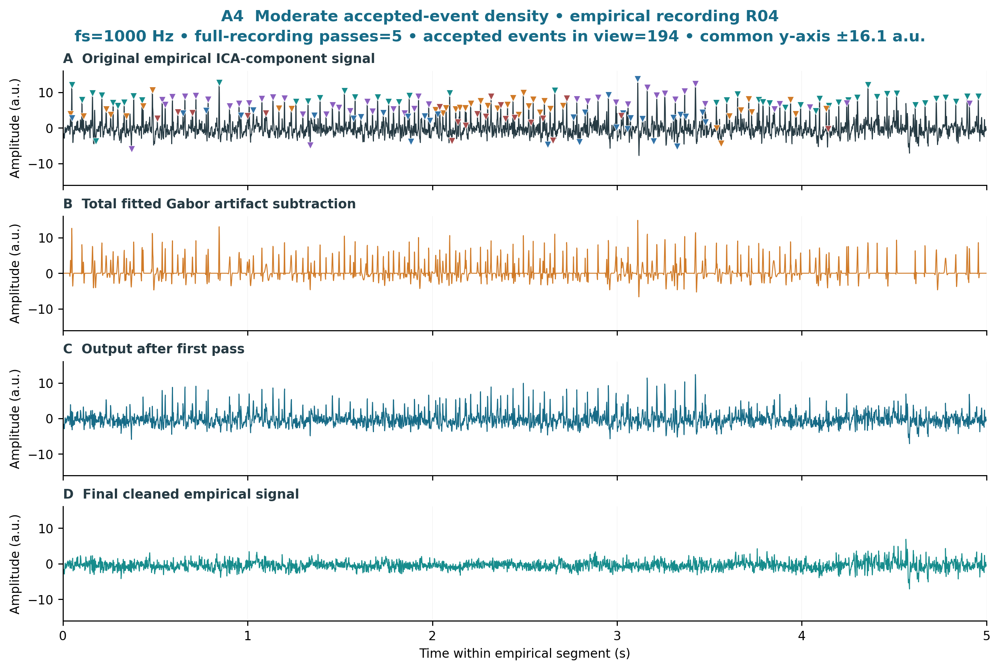
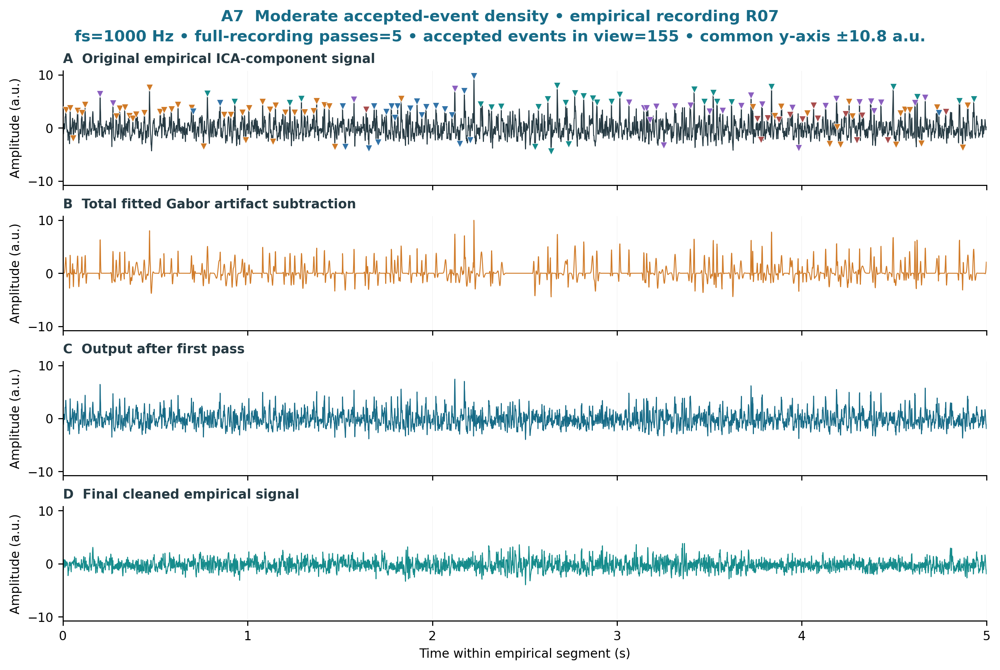
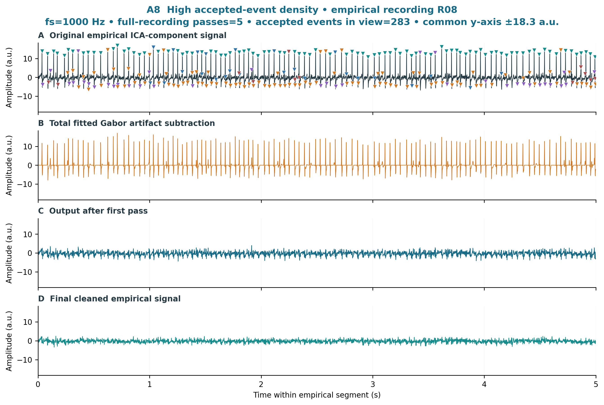
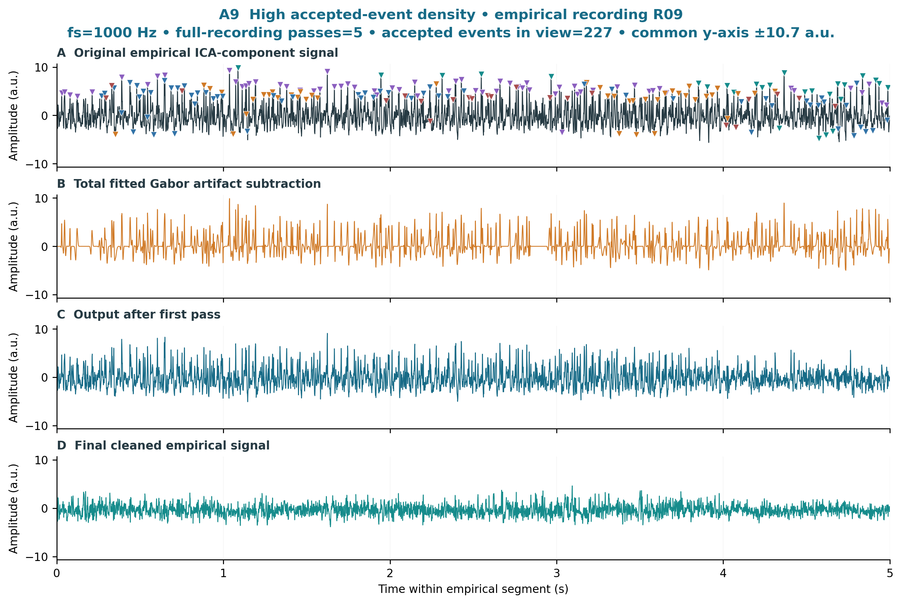

# Empirical EEG/ICA cleaning examples

The six scientific examples below are genuine, contiguous five-second
ICA-component intervals from the validated benchmark recordings. The frozen
native C++ cleaner was run on each complete 30-second recording before the
displayed interval was extracted, so event detection retained its original
continuous-recording context.

Every figure shows the original empirical signal with genuine accepted-event
markers, cumulative fitted subtraction computed as `original - final cleaned`,
the first-pass result where informative, and the final cleaned signal. All
panels within a figure use the same amplitude limits and span exactly 0–5 s.
No spikes, noise, smoothing or fitted curves were added or edited.

The public figures use neutral recording codes and contain no participant or
source-recording identifiers. Original signals, numerical arrays, event-level
provenance and source hashes remain outside this repository.

The six established PNG filenames are retained for compatibility with existing
links. The captions and figure headers state the actual recording properties:
in particular, `sampling_500_hz.png` contains 1000 Hz empirical example A7, and
`three_passes.png` contains the final result after five full-recording passes.

## 1. Lower-density interval with a dominant burst

A1 contains a localized high-amplitude burst followed by quieter empirical
activity. Later cleaning passes also accept smaller events in the surrounding
recording.



## 2. Lower-density distributed activity

A2 shows lower-amplitude empirical activity with scattered accepted transients
and three configured full-recording passes.



## 3. Moderate-density activity

A4 contains frequent narrow events and changing background amplitude. The
subtraction and final signal are actual cumulative outputs of five native passes.



## 4. Moderate-density multi-pass behavior

A7 illustrates irregular event amplitudes and the difference between the first
pass and final five-pass result. Additional passes do not guarantee improvement;
inspect each incremental subtraction before selecting a pass count.



## 5. High-density activity

A8 shows sustained dense, high-amplitude transient activity. It is a genuine
recording interval, not the periodic synthetic train used in the earlier draft.



## 6. Heterogeneous high-density activity

A9 combines dense activity with substantial amplitude variation. Residual
activity is displayed honestly on the same amplitude scale as the original and
subtraction panels.



## Synthetic numerical fixtures

Synthetic signals remain available strictly for reproducible interface and
regression testing:

```bash
PYTHONPATH=python python examples/generate_examples.py
```

The script writes clearly labelled numerical test outputs under
`examples/generated/synthetic_test_outputs/`. These fixtures test sampling
frequencies, event spacing and pass behavior; they are not presented as
representative EEG cleaning results. The compact command-line example
`gaborfit_clean_example` and `examples/clean_synthetic.py` remain minimal API
smoke tests without scientific-performance claims.
